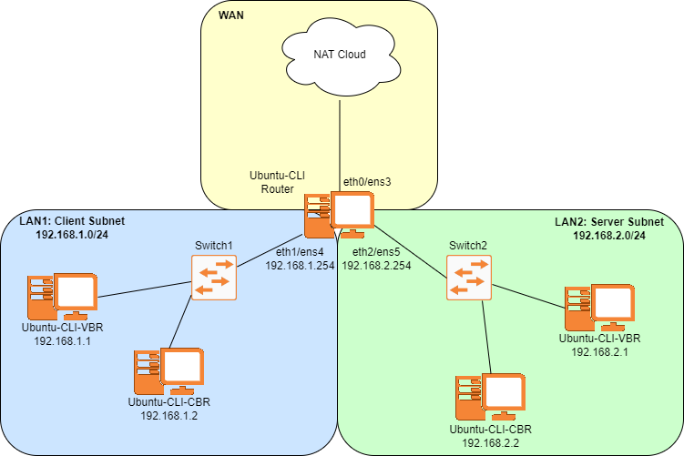

# L4S-Lab-1
The objective of this lab is to establish a performance baseline for "Classic" congestion control algorithms within a constrained network environment. In modern networking, the dominant challenge is not just throughput, but bufferbloat. Bufferbloat is the high latency caused by long queues in network devices.

Classic congestion control algorithms like TCP Reno and TCP Cubic rely on Packet Loss as the primary signal for congestion.

TCP Reno: Uses an Additive Increase Multiplicative Decrease (AIMD) approach. It increases the congestion window linearly and cuts it by 50% upon detecting a packet drop.

TCP Cubic: Uses a cubic function to grow the window, allowing for faster recovery in high-bandwidth, high-latency networks, but it still cuts its congestion window significantly when detecting a packet drop.

In this lab, we will use a pfifo (First-In, First-Out) queue at the bottleneck router. Because pfifo is "dumb" and has no active queue management and wont prioritize certain types of traffic, the sender will continue to push data until the router's buffer is completely exhausted, leading to maximum queuing delay before the sender finally slows down.


In the commands below, text enclosed in angle brackets (e.g., <BITRATE>) acts as a placeholder. Please replace it with your specific experimental value

# Task 1

## Network Diagram


## IP Grid

| Name           | Interface     | Address/Mask     |
|----------------|---------------|------------------|
| **WAN** | | 
| Ubuntu-CLI-Router    | ens3 |DHCP
||
| **Client LAN** ||192.168.1.0/24
| Ubuntu-CLI-Router        |ens4 |192.168.1.254/24
| Ubuntu-CLI-VBR-Client    |ens3 |192.168.1.1
| Ubuntu-CLI-CBR-Client    |ens3 |192.168.1.2
| |
| **Server LAN**       ||192.168.2.0/24
| Ubuntu-CLI-Router        |ens5|192.168.2.254/24
| Ubuntu-CLI-VBR-Server    |ens3|192.168.2.1
| Ubuntu-CLI-CBR-Server    |ens3|192.168.2.2

## Configuration
1. Start a new blank project in GNS3 called "L4S-Lab1" and create the network shown in the diagram above
3. Right click on the Ubuntu-CLI-Router and enter the Configuration window
4. Click on the network tab and change "Adapters" to 3
5. Start the Ubuntu-CLI-Router and give it a hostname and run the following command,

   ```
   sudo nmcli general hostname Ubuntu-CLI-Router
   sudo nano /etc/netplan/50-cloud-init.yaml
   ```
   
6. And have your .yaml file look like this,

   ```
   network:
     version: 2
     renderer: NetworkManager
     ethernets:
       ens3:
         dhcp4: yes
         dhcp4-overrides:
           use-dns: true
           use-routes: true
       ens4:
         dhcp4: no
         addresses:
           - 192.168.1.254/24
       ens5:
         dhcp4: no
         addresses:
           - 192.168.2.254/24
     ```

7. Apply these changes

   ```
   sudo netplan apply
   ```

8. Reboot the machine and use ```ip a``` to verify all three interfaces got an address

9. Apply a NAT to allow client and server machines to download new kernel

   ```
   sudo iptables -t nat -A POSTROUTING -o ens3 -j MASQUERADE
   sudo iptables -A FORWARD -i ens4 -o ens3 -j ACCEPT
   sudo iptables -A FORWARD -i ens5 -o ens3 -j ACCEPT
   sudo iptables -A FORWARD -i ens3 -m state --state RELATED,ESTABLISHED -j ACCEPT
   ```

10. Now you need to enable IPv4 forwarding so it can act as a router

   ```
   sudo nano /etc/sysctl.conf
   ```

11. Find the line that looks like ```#net.ipv4.ip_forward=1``` and uncomment it and load the new changes

    ```
    sudo sysctl -p
    ```

12. Start and configure all client and server Ubuntu devices

    ```
    sudo nmcli general hostname Ubuntu-CLI-<CHECK IP GRID>
    sudo nmcli con mod "Wired connection 1" ipv4.addresses <CHECK IP GRID/MASK>
    sudo nmcli con mod "Wired connection 1" ipv4.gateway <CHECK IP GRID>
    sudo nmcli con mod "Wired connection 1" ipv4.dns 8.8.8.8,8.8.4.4
    sudo nmcli con mod "Wired connection 1" ipv4.method manual
    sudo nmcli connection down "Wired connection 1"
    sudo nmcli connection up "Wired connection 1"
    ```

13. We then will install ffmpeg on both the Ubuntu-CLI-VBR-Client and Ubuntu-CLI-VBR-Server for later use

    ```
    sudo apt-get update && sudo apt install ffmpeg -y
    ```

13. At this point all devices are able to reach each other and a reliable IP address (Ask instructor for help if this isn't working for you)

# Task 2

## Congestion Control and Setting up the Queue

14. Use these commands on each device to set the congestion control algorithm to TCP Reno and ECN to 0

    ```
    sudo sysctl -w net.ipv4.tcp_congestion_control=reno
    sudo sysctl -w net.ipv4.tcp_ecn=0
    ```

15. For testing using classic congestion control algorithms like TCP Reno and Cubic. We could use the default queue that Ubuntu uses but to ensure no packets are prioritized based on the traffic type, we will use a PFIFO (Packet First in, First Out). For eth1/ens4 on the Ubuntu-CLI-Router, we will use the following command

    ```
    sudo tc qdisc replace dev ens4 root pfifo limit 18
    ```

16. The bandwidth between on the virtual links can support up to 50 Mbps. To be able to generate traffic and see the Congestion Experienced mark in Wireshark, we have to set a bandwidth limit between the router and servers. To do this we first create the traffic shaper which tells Ubuntu to not exceed the set limit and the second command sets the queue to a pfifo queue with a limit of 18 packets. You will run this command on the router and both servers

    ```
    sudo tc qdisc add dev ens<REPLACE WITH INTERFACE NUMBER> root handle 1: tbf rate 1mbit burst 1540b latency 50ms
    sudo tc qdisc add dev ens<REPLACE WITH INTERFACE NUMBER> parent 1: pfifo limit 18
    ```

# Task 3

## Collecting Data from TCP Trace

17. TCP Trace captures low-level kernel instrumentation of the TCP stack. This will show exactly how your TCP Reno or Cubic flows are behaving at the congestion control level
18. Below is an example of a couple lines you will capture in your trace files

    ```
     <idle>-0       [001] .Ns.. 1394014.593425: tcp_probe: family=AF_INET src=192.168.2.1:5000 dest=192.168.1.1:51870 mark=0x0 data_len=0 snd_nxt=0xb26b4d01 snd_una=0xb26b3769 snd_cwnd=38 ssthresh=2147483647
    snd_wnd=78464 srtt=333576 srtt_pace=0 min_rtt=5251 mrtt_pace=0 mdev_pace=0 rcv_wnd=65280 sock_cookie=7b classic_ecn=0 alpha=0
          ffmpeg-52980   [001] ..s.. 1394015.278197: tcp_probe: family=AF_INET src=192.168.2.1:5000 dest=192.168.1.1:51870 mark=0x0 data_len=0 snd_nxt=0xb26b6d89 snd_una=0xb26b41b1 snd_cwnd=24
    ssthresh=2147483647 snd_wnd=78080 srtt=332757 srtt_pace=0 min_rtt=5251 mrtt_pace=0 mdev_pace=0 rcv_wnd=65280 sock_cookie=7b classic_ecn=0 alpha=0
    ```

19. You can see this will collect a lot of information but it contains crucial data about how each congestion control algorithim reacts to congestion. For example, find the label "snd_cwnd", you will see that in the first tcp_probe that it is equal to 38 and in the second one it has decreased to 24. This shows that there was a packet dropped to signal congestion and the window size has decreased to accommodate this
20. In order for you to collect this data on the Ubuntu-CLI-VBR-Server. We need to be running all commands as a root user

    ```
    sudo -s
    ```

21. We first will switch to the directory with TCP trace and enable it

    ```
    cd /sys/kernel/debug/tracing
    ```
    ```
    echo 1 > events/tcp/tcp_probe/enable
    ```

## Sending Variable and Constant Bit Rate Traffic

22. To simulate a real world network. We will generate Constant Bit Rate traffic that acts as background traffic in a network and Variable Bit Rate traffic that acts as the user's traffic (such as streaming videos on Youtube)
23. To generate the background CBR traffic we will use iperf3 to generate UDP traffic through the network, The following command will set the Ubuntu-CLI-CBR-Server to act as a server waiting for a request from a client

    ```
    iperf3 -s
    ```

24. This next command will generate the TCP VBR traffic using ffmpeg. This command will also set the Ubuntu-CLI-VBR-Server to act as a server waiting for a request from a client

    ```
    ffmpeg -re -f lavfi -i testsrc=size=720x480:rate=30 -c:v libx264 -crf 25 -b:v 500k -maxrate 500k -bufsize 500k -f mpegts tcp://0.0.0.0:5000?listen
    ```

25. Before we start generating traffic, right click on the link between the Ubuntu-CLI-Router and the switch and start a Wireshark capture so that you can see traffic from both the CBR and VBR server
26. We will start the background traffic on the Ubuntu-CLI-CBR-Client first at 200Kbps and slowly raise the bit rate

    ```
    iperf3 -c 192.168.2.2 -u -b 200k -t 0
    ```

27. We can now start the VBR data stream on the Ubuntu-CLI-VBR-Client with the following command,

    ```
    ffmpeg -i tcp://192.168.2.1:5000 -f null -
    ```

28. Let the VBR traffic run for 5 minutes or so in order to collect data and use ctrl+c to stop the data streams
29. We then need to stop the TCP trace

    ```
    echo 0 > events/tcp/tcp_probe/enable
    ```
    
30. Save the trace file to the itsclass directory. Save the file name as the bit rate and congestion control algorithim used in iperf3 (For example: Reno200KbpsTrace)

    ```
    cp trace /home/itsclass/<filename>
    ```

31. Now clear the current trace file so you can collect more data

    ```
    head -12 trace > trace
    ```
    
32. Stop the Wireshark capture and save it as Lab1-Reno-<BITRATE>. You will now run the data stream from step 18 three more times and raising the CBR bit rate each time by 400 Kbps (200Kbps, 600Kbps, 1000Kbps, and 1400Kbps)
33. Save all four Wireshark captures for later comparison during Lab 2
34. You will now change the congestion control to TCP Cubic using the following command

    ```
    sudo sysctl -w net.ipv4.tcp_congestion_control=cubic
    sudo sysctl -w net.ipv4.tcp_ecn=0
    ```

35. You will now run the data stream starting from step 18 four times and raising the CBR bit rate each time by 400 Kbps (200Kbps, 600Kbps, 1000Kbps, and 1400Kbps)
36. Stop and save these Wireshark captures as Lab1-Cubic-<BITRATE>

# Task 4

## Examining Results

37. Open a new terminal in your gHost so we can calculate the mean RTT of each Wireshark capture using the following command. Make sure you're in the same directory as your captures.

    ```
    tshark -r <NAME OF PCAP>.pcapng -Y "tcp.analysis.ack_rtt" -T fields -e tcp.analysis.ack_rtt | awk '{ sum += $1; n++ } END { if (n > 0) print sum / n; else print "No RTT data found"; }'
    ```

38. Create a table and save these values for comparison

|   |   A   |   B   |   C   |   D   |
|---|-------|-------|-------|-------|
| VBR Client to VBR Server | Level 1  | Level 1  |  Level 1  |  Level 1 
| CBR Client to CBR Server | 200 Kbps | 600 Kbps | 1000 Kbps | 1400 Kbps 
|          Mean RTT        |          |          |           |           

39. **POSSIBLE CWD GRAPH-TALK TO JULIO**
